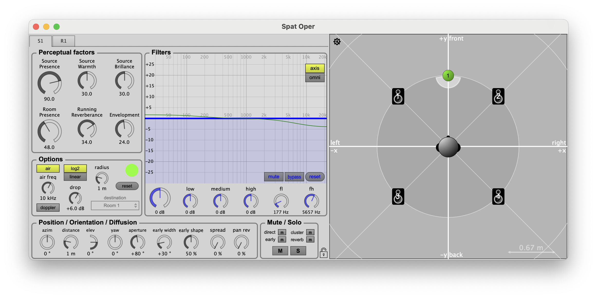

<!--
MODE D'EMPLOI
Ce fichier est la source du texte de la page. Modifier librement les phrases.
Garder seulement la structure :
  ## = une section de la page
  ### = une étape, une fiche objet ou une piste « aller plus loin »
  - **Rôle :** etc. = les rubriques d'une fiche (on peut en ajouter ou en retirer)
  > = un encadré (> **Attention :** = encadré d'avertissement)
  - [ ] = une case à cocher dans « À essayer »
  ```…``` = un bloc de code avec bouton « Copier »
Le dessin du patch, les pastilles et les démos interactives sont générés à part :
inutile de les décrire ici.
-->


# Simple spat : mise en espace d'une source sonore avec quatre haut-parleurs

On fabrique également ici un son rythmé (sinus + bruit rose, découpé par une enveloppe), envoyé au Spat 5 qui le place dans l'espace autour de l'auditeur, sur quatre haut-parleurs.


## Le patch, étape par étape

### 1. La matière sonore
`cycle~ 400` produit un sinus à 400 Hz. `pink~` produit un bruit rose, qu'on atténue fortement avec `*~ 0.1` (environ −20 dB). `+~` additionne les deux : c'est un mélangeur.

### 2. Le rythme et l'enveloppe
Le premier toggle lance `metro 500`. À chaque bang, le second toggle bascule : 1, 0, 1, 0… `adsr~` lit 1 comme « note on » (attaque) et 0 comme « note off » (relâchement). On obtient une note de 500 ms, toutes les secondes.

### 3. Le VCA
Le `*~` sans argument multiplie le son par l'enveloppe. Quand l'enveloppe vaut 0, silence ; quand elle vaut 1, plein volume. C'est exactement comme le VCA (Voltage Controlled Amplifier) d'un synthé : l'amplificateur piloté par l'enveloppe.

### 4. Positionner le son dans l'espace
Les boîtes nombre envoient des valeurs dans des messages OSC : `/source/1/az $1` (azimut seul) ou, via `pak`, `/source/1/ad $1 $2` (azimut + distance).

OSC (Open Sound Control) est un format de message en forme de chemin, comme `/source/1/az`, suivi de valeurs. Spat 5 se pilote entièrement ainsi.

### 5. Le tableau de bord : spat5.oper
Il reçoit les messages, met à jour son interface (double-cliquer pour l'ouvrir) et les transmet à `spat5.spat~`. Son `@initwith` déclare 1 source et 4 haut-parleurs positionnés à −45°, 45°, −135° et 135°.

### 6. Le moteur (spatialisateur audio) et la sortie
`spat5.spat~` calcule quatre signaux (panoramique, distance, réverbération), un par haut-parleur, envoyés vers `dac~ 1 2 3 4`. Le `ezdac~` allume et éteint l'audio.


## Avant de commencer

> **Installer Spat 5.** Spat est une bibliothèque de l'IRCAM, à télécharger sur le Forum IRCAM (compte gratuit, libre d'usage pour la recherche et la création). Copier le dossier `spat5` dans le dossier `Packages` de Max (en général `Documents/Max 9/Packages`), puis relancer Max.

> **Attention : comment écouter quatre sorties au casque ?** `dac~ 1 2 3 4` envoie vers les canaux 1 à 4 de la carte son. Avec une sortie stéréo, on n'entend que les haut-parleurs 1 et 2 (l'avant). On peut aussi y ajouter les canaux 3 et 4 en assignant leurs sorties physiques sur 1 et 2, dans **Options › Audio Status › I/O Mappings** : on entend alors les quatre haut-parleurs, mais on perd la différence avant / arrière. Ou bien passer en binaural (voir « Aller plus loin »).

> **Les conventions de Spat.** L'azimut est en degrés : 0° devant, 90° à droite, −90° à gauche, ±180° derrière. La distance est en mètres.


## L'interface de spat5.oper



Double-cliquer sur `spat5.oper` (patch verrouillé) pour l'ouvrir. À droite, la vue du dessus : la source verte (1) et les quatre haut-parleurs. On peut aussi déplacer la source à la souris.


## Les objets à connaître

### `cycle~ 400`
- **Rôle :** Oscillateur sinusoïdal (cosinus, pour être exact). L'argument est la fréquence en Hz.
- **Entrées / sorties :** Gauche : fréquence (nombre ou signal). Droite : phase (0 à 1). Sortie : signal entre −1 et 1.
- **Le piège :** Il sort à pleine amplitude. Si on lui ajoute le bruit, le total dépasse 1 : penser à baisser le niveau avant de mélanger.
- **Voisins :** `saw~`, `rect~`, `tri~`, `phasor~`

### `pink~`
- **Rôle :** Bruit rose : même énergie dans chaque octave. Plus doux à l'oreille que le bruit blanc.
- **Entrées / sorties :** Aucun réglage. Une sortie signal.
- **Le piège :** Le bruit, c'est fort : sans `*~ 0.1`, il couvre le sinus.
- **Voisins :** `noise~` (blanc), `rand~`

### `+~` · `*~`
- **Rôle :** `+~` additionne deux signaux : c'est un mélangeur. `*~` multiplie : avec un nombre, c'est un volume (`*~ 0.1` ≈ −20 dB) ; avec un autre signal (l'enveloppe), c'est un VCA.
- **Entrées / sorties :** Deux entrées (signal ou nombre), une sortie signal.
- **Le piège :** Le volume n'est pas linéaire à l'oreille : 0.5 = −6 dB, pas « la moitié du volume ». Voir `dbtoa`.
- **Voisins :** `-~`, `/~`, `gain~`, `live.gain~`

### `metro 500`
- **Rôle :** Envoie un bang à intervalle régulier (ici toutes les 500 ms) tant qu'il est allumé.
- **Entrées / sorties :** Gauche : 1 / 0 (ou toggle) pour démarrer et arrêter. Droite : nouvel intervalle en ms. Sortie : bang.
- **Le piège :** Ici, la note dure un intervalle et le silence un autre : la période réelle est de 1 seconde, pas 500 ms.
- **Voisins :** `tempo`, `transport`, `qmetro`

### `toggle`
- **Rôle :** Interrupteur : sort 1 ou 0. Chaque bang le fait basculer.
- **Dans ce patch :** L'astuce du cours : `metro` → `toggle` produit 1, 0, 1, 0… soit une alternance note on / note off, une « porte » (gate) parfaite pour `adsr~`.
- **Le piège :** Le toggle envoie 1 quand on l'allume : le premier bang du metro donne une attaque, pas un silence.
- **Voisins :** `button`, `live.toggle`, `counter`

### `adsr~ 5 50 0.5 200`
- **Rôle :** Générateur d'enveloppe. Arguments : attack (ms), decay (ms), sustain (niveau 0–1), release (ms).
- **Entrées / sorties :** Gauche : un nombre non nul déclenche l'attaque (et fixe le pic), 0 déclenche le release. Les autres entrées changent A, D, S, R. Ici, seule la sortie de gauche (le signal d'enveloppe) est utilisée.
- **Le piège :** Le sustain est un niveau, pas une durée. Et si la note est plus courte que A + D, on passe directement au release.
- **Voisins :** `line~`, `curve~`, `function` + `line~`

### `flonum` · `message $1`
- **Rôle :** La boîte nombre (flottant) envoie la valeur qu'on règle à la souris. La boîte message remplace `$1`, `$2`… par ce qu'elle reçoit, puis envoie le tout.
- **Dans ce patch :** `45` dans `/source/1/az $1` devient `/source/1/az 45` : une adresse OSC (le chemin) suivie d'une valeur.
- **Le piège :** Un clic sur un message contenant `$1` sans rien recevoir envoie 0. Et le patch doit être verrouillé (⌘E / Ctrl+E) pour faire glisser les nombres.
- **Voisins :** `number` (entier), `sprintf`, `prepend`

### `pak 0. 1.`
- **Rôle :** Assemble plusieurs valeurs en une liste. Ici : azimut + distance, envoyés ensemble.
- **pak ou pack ? :** Avec `pack`, seule l'entrée de gauche déclenche la sortie (entrée « chaude »). Avec `pak`, toutes les entrées sont chaudes : bouger la distance renvoie aussi la liste.
- **Le piège :** Les arguments fixent le type : `pak 0 1` arrondirait tout en entiers. Le point de `0.` compte !
- **Voisins :** `pack`, `join`, `unpack`

### `spat5.oper @initwith "…"`
- **Rôle :** L'interface de contrôle de Spat : facteurs perceptifs, position, filtres, réverbération. Il reçoit des messages OSC et les transmet au moteur.
- **Dans ce patch :** `@initwith` envoie au démarrage : `/source/number 1`, `/speaker/number 4`, `/speakers/az -45 45 -135 135`, un carré de haut-parleurs (avant gauche, avant droite, arrière gauche, arrière droite).
- **Le piège :** Il se branche dans l'entrée de gauche de `spat5.spat~`, la même que l'audio de la source 1 : cette entrée accepte les deux.
- **Voisins :** `spat5.viewer` (vue seule), `spat5.osc.route`

### `spat5.spat~ @inputs 4 @outputs 4`
- **Rôle :** Le moteur : à partir de chaque source, il calcule un signal par haut-parleur (panoramique, effet de distance, réverbération).
- **Entrées / sorties :** `@inputs` = nombre de sources (entrées audio), `@outputs` = nombre de haut-parleurs (sorties audio).
- **Le piège :** Ici, 4 entrées sont créées mais l'oper ne déclare qu'une source : seule la première sert. Bonne habitude : faire correspondre `@inputs` et `/source/number`.
- **Voisins :** `spat5.pan~` (sans réverb), `spat5.binaural~`, `spat5.panoramix~`

### `dac~ 1 2 3 4` · `ezdac~`
- **Rôle :** Digital-to-analog converter : la sortie vers la carte son. Les arguments sont les numéros de canaux. `ezdac~` est le bouton pour allumer et éteindre l'audio.
- **Entrées / sorties :** Une entrée signal par canal, pas de sortie.
- **Le piège :** Aucun son ? Audio éteint (ezdac~), mauvaise carte son dans Audio Status, ou canaux 3–4 inexistants sur l'interface.
- **Voisins :** `mc.dac~`, `adc~` (l'entrée), `meter~`


## À essayer

- [ ] Azimut à 0, 90, 180, −90 : où entend-on le son ? Pourquoi 45 tombe-t-il pile sur un haut-parleur ?
- [ ] Distance à 1, puis 5, puis 20 : qu'est-ce qui change, le volume seulement ? Regarder l'oper pendant ce temps.
- [ ] Remplacer `metro 500` par `metro 100`. Que devient l'enveloppe ? (indice : le release dure 200 ms)
- [ ] Mettre une attaque de 500 ms dans `adsr~`. Pourquoi le son n'atteint-il plus jamais son maximum ?
- [ ] Débrancher `cycle~` pour garder le bruit seul. Le son est-il plus facile ou plus difficile à localiser ? Et le sinus seul ?


## Pourquoi le bruit se localise mieux

Notre oreille situe un son grâce aux différences entre les deux oreilles : de temps d'arrivée, de niveau, et de filtrage par la tête et le pavillon. Un sinus pur ne donne qu'une seule fréquence à comparer, donc peu d'indices. Un bruit couvre tout le spectre et les fournit tous à la fois.

C'est pour ça qu'on mélange ici un peu de bruit rose au sinus. Et c'est pour ça que les sons graves et purs « flottent » partout dans une salle.


## Aller plus loin

> **À rendre.** Au moins deux exercices au choix parmi les suivants (ou plus 🙂). Déposer les patchs sur Discord, dans le canal rendus.

> **Lire les mini-patchs.** Les exemples ci-dessous sont écrits en notation pseudo-Max : à reconstruire soi-même dans Max.
> - `[metro 500]` entre crochets = un **objet** (touche **N** dans un patch déverrouillé)
> - `[-180, 180 4000(` crochet + parenthèse = une **boîte message** (touche **M**)
> - `|` = un **câble**, de la sortie de l'objet du dessus vers l'entrée de l'objet du dessous
> - `→ spat5.oper` = envoyer vers cet objet, déjà présent dans le patch

### Faire tourner le son tout seul · facile
Remplacer la boîte azimut par une rampe : `line` va de −180 à 180 en 4 secondes, avec une valeur toutes les 20 ms.
```
[-180, 180 4000(
   |
[line 0. 20]
   |
[/source/1/az $1(  →  spat5.oper
```
Mettre le message dans un `metro 4000` pour que ça tourne en boucle.

### Une note, une place · facile
Brancher aussi le `metro` sur un `random` : chaque note part d'un endroit différent.
```
[metro 500]
   |
[random 360]
   |
[- 180]
   |
[/source/1/az $1(
```

### Écouter au casque · intermédiaire
Pas de quadriphonie sous la main ? Passer Spat en binaural : deux sorties, et le panoramique simule l'écoute à 360° au casque.
```
[spat5.spat~ @inputs 1 @outputs 2]
[/panning/type binaural(  →  spat5.oper
[dac~ 1 2]
```
Ça marche au casque seulement. Les sources derrière restent souvent plus difficiles à percevoir que celles de devant.

### Deux sources · intermédiaire
Déclarer une seconde source, brancher un autre son dans la deuxième entrée de `spat5.spat~`, et la piloter avec `/source/2/…`.
```
[spat5.oper @initwith "/source/number 2, /speaker/number 4, /speakers/az -45 45 -135 135"]

[/source/2/az $1(  →  spat5.oper
```

### Un anneau de huit haut-parleurs · avancé
Même patch, plus de haut-parleurs. Il faut changer trois endroits : l'oper, le moteur et la sortie.
```
[spat5.oper @initwith "/source/number 1, /speaker/number 8, /speakers/az 0 45 90 135 180 -135 -90 -45"]
[spat5.spat~ @inputs 1 @outputs 8]
[dac~ 1 2 3 4 5 6 7 8]
```

### Écouter l'OSC · facile
Brancher un `print oper` sur la sortie de gauche de `spat5.oper`, ouvrir la console Max, et bouger la source à la souris dans l'oper. On voit tous les messages qu'il envoie au moteur, et on apprend le vocabulaire de Spat.
```
[spat5.oper]
   |
[print oper]
```


## Ressources

Dans Max : clic droit (ou Alt-clic, patch déverrouillé) sur un objet › **Open Help**. Le package Spat 5 contient aussi des tutoriels (`spat5.tuto-…`), à chercher dans le navigateur de fichiers de Max.

- [Forum IRCAM, page Spat 5](https://forum.ircam.fr/topics/detail/45-Spat5)
- [Installer Spat 5 (à lire d'abord)](https://discussion.forum.ircam.fr/t/spat5-for-max-read-this-first/21628)
- [Documentation Max (Cycling '74)](https://docs.cycling74.com)
